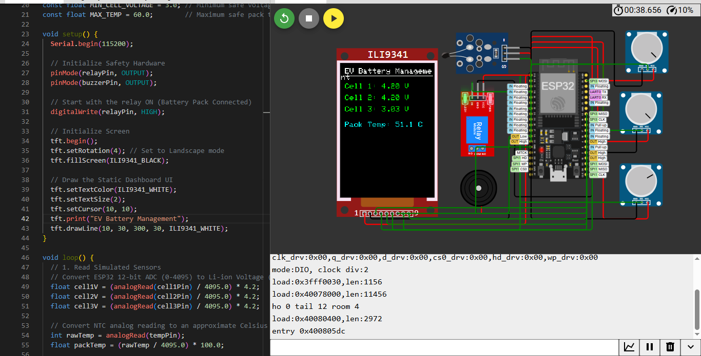
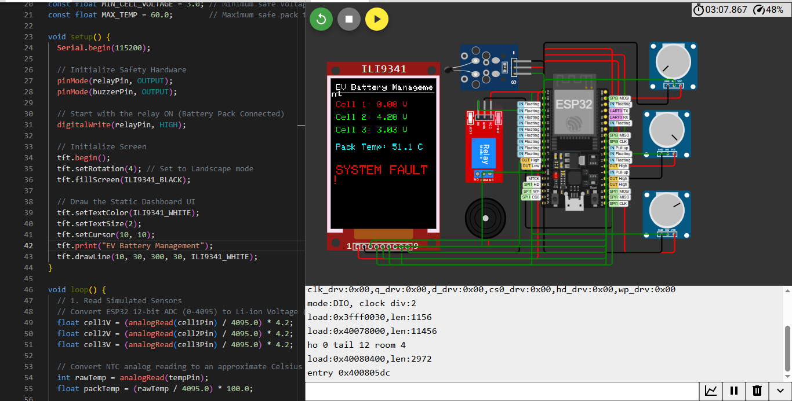

# EV-BMS-Hardware-Simulation
## Overview
This project is a C++ based embedded systems simulation of a master control unit for an Electric Vehicle Battery Management System (BMS). It demonstrates real-time analog data acquisition, SPI display telemetry, and hardware safety cutoff logic.

## System Architecture
* Microcontroller: ESP32
* Display: ILI9341 TFT LCD
* Inputs: 3x Potentiometers & 1x NTC Thermistor
* Outputs: 5V Relay & Piezo Buzzer

## Core Features
* Thermal Protection: Triggers a system fault if the pack temperature exceeds 45.0°C.
* Under-Voltage Lockout: Triggers a system fault if any cell drops below 3.0V.
* Hardware Interlock: Commands the relay to open upon detecting a fault to prevent thermal runaway.
*
